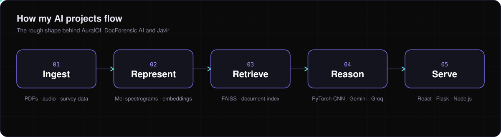

 

---

## 👋 About me

I'm a Computer Science graduate (B.Tech, RTMNU Nagpur, 2026) who builds AI-powered applications and the full-stack software around them. My projects cover RAG-based document tools, deep learning for audio, and real-time web apps.

- 🔭 Building **VentureFlock**, a founder networking platform I co-founded (React, Express, PostgreSQL, Redis, Socket.IO)
- 🧠 Working with **PyTorch, FAISS and LLM APIs** on retrieval and audio-analysis projects
- 🏆 **2nd place** at the 24-hour national MECL hackathon
- 📄 Published: *EVENTO: A Centralized Platform for Inter-College Event Discovery* (IJSREM, 2024)
- 🎯 Long-term direction: **AI & Cloud Architecture**
- 📍 Nagpur, India · open to AI/ML and full-stack roles

## 🚀 Featured projects

| Project | What it does | Stack |
|---|---|---|
| **[AuralOf](https://github.com/Mr-PratikTikhe/AuralOf)** | Tells human-made music from AI-generated music using a custom PyTorch CNN on Mel spectrograms, and finds similar tracks with FAISS vector search over TorchOpenL3 embeddings | `PyTorch` `Flask` `React` `FAISS` |
| **[DocForensic AI](https://github.com/Mr-PratikTikhe/DocForensicAI)** | Document workspace for long PDFs: extraction, indexing, Gemini-powered Q&A grounded in the document, plus quizzes and flashcards for study | `Gemini` `RAG` `PDF extraction` |
| **[Javir](https://pratikexe.vercel.app/)** | Portfolio assistant that answers from verified FAQ data first and only then calls an LLM (Groq, GPT-OSS 120B). Optional in-browser inference with WebLLM and WebGPU | `React` `TypeScript` `Node.js` `WebGPU` |
| **[VentureFlock](https://ventureflock.com/)** | Networking platform for founders with feeds, communities, real-time chat, notifications and asset uploads | `React` `Express` `PostgreSQL` `Redis` `Socket.IO` |
| **[Geological AI Chatbot](https://github.com/Mr-PratikTikhe/geochatbot)** | ML anomaly detection over geological survey data with interactive maps and a domain-specific chatbot. 🥈 MECL hackathon | `Python` `Streamlit` `Scikit-learn` `NLP` |

## 🛠️ Tech stack

**AI / ML** 

**Backend & data** 

**Frontend** 

**Languages & tools** 

## 📊 GitHub activity

## 🐍 Contribution snake

<picture>
  <source media="(prefers-color-scheme: dark)" srcset="https://raw.githubusercontent.com/Mr-PratikTikhe/Mr-PratikTikhe/output/github-snake-dark.svg">
  <source media="(prefers-color-scheme: light)" srcset="https://raw.githubusercontent.com/Mr-PratikTikhe/Mr-PratikTikhe/output/github-snake.svg">
  
</picture>

## 📫 Let's connect

I'm happy to talk about AI/ML projects, retrieval systems, full-stack work, or early-career roles. Email is the fastest way to reach me: **pratiktikhe2004@gmail.com**

