 

---

## 👋 About me

I'm a Computer Science graduate (B.Tech, RTMNU Nagpur, 2026) who builds AI-powered applications and the full-stack software around them. My projects cover RAG-based document tools, deep learning for audio, and real-time web apps.

- 🔭 Building **VentureFlock**, a founder networking platform I co-founded (React, Express, PostgreSQL, Redis, Socket.IO)
- 🧠 Working with **PyTorch, FAISS and LLM APIs** on retrieval and audio-analysis projects
- 🏆 **2nd place** at the 24-hour national MECL hackathon
- 📄 Published: *EVENTO: A Centralized Platform for Inter-College Event Discovery* (IJSREM, 2024)
- 🎯 Long-term direction: **AI & Cloud Architecture**
- 📍 Nagpur, India · open to AI/ML and full-stack roles

## 🚀 Featured projects

SELECTED WORK &nbsp;·&nbsp; AI / ML &nbsp;·&nbsp; FULL-STACK ENGINEERING

<table>
<tr>
<td width="50%" valign="top">
<h3>🎧 <a href="https://github.com/Mr-PratikTikhe/AuralOf">AuralOf</a></h3>

Detects AI-generated music with a custom PyTorch CNN, then finds similar tracks through FAISS and TorchOpenL3 embeddings.

<code>PyTorch</code> <code>Flask</code> <code>React</code> <code>FAISS</code>

</td>
<td width="50%" valign="top">
<h3>📄 <a href="https://github.com/Mr-PratikTikhe/DocForensicAI">DocForensic AI</a></h3>

A workspace for long PDFs with extraction, indexing, grounded Gemini Q&amp;A, quizzes, and flashcards.

<code>Gemini</code> <code>RAG</code> <code>PDF extraction</code>

</td>
</tr>
<tr>
<td width="50%" valign="top">
<h3>🤖 <a href="https://pratikexe.vercel.app/">Javir</a></h3>

A portfolio assistant that answers from verified FAQ data first, with optional WebLLM inference in the browser.

<code>React</code> <code>TypeScript</code> <code>Node.js</code> <code>WebGPU</code>

</td>
<td width="50%" valign="top">
<h3>🌐 <a href="https://ventureflock.com/">VentureFlock</a></h3>

A founder network for feeds, communities, real-time chat, notifications, and asset sharing.

<code>React</code> <code>Express</code> <code>PostgreSQL</code> <code>Redis</code> <code>Socket.IO</code>

</td>
</tr>
<tr>
<td width="50%" valign="top">
<h3>🗺️ <a href="https://github.com/Mr-PratikTikhe/geochatbot">Geological AI Chatbot</a></h3>

Explores geological survey data with ML anomaly detection, interactive maps, and a domain-specific chatbot. 🥈 MECL hackathon

<code>Python</code> <code>Streamlit</code> <code>Scikit-learn</code> <code>NLP</code>

</td>
<td width="50%" valign="top">
<h3>✦ More in progress</h3>

Building practical AI systems and the full-stack products around them.

<code>Retrieval</code> <code>Deep learning</code> <code>Cloud</code>

</td>
</tr>
</table>

## 🛠️ Tech stack

**AI / ML** 

**Backend & data** 

**Frontend** 

**Languages & tools** 

## 📊 GitHub stats

## 🐍 Contribution snake

<picture>
  <source media="(prefers-color-scheme: dark)" srcset="https://raw.githubusercontent.com/Mr-PratikTikhe/Mr-PratikTikhe/output/github-snake-dark.svg">
  <source media="(prefers-color-scheme: light)" srcset="https://raw.githubusercontent.com/Mr-PratikTikhe/Mr-PratikTikhe/output/github-snake.svg">
  
</picture>

## 📫 Let's connect

I'm happy to talk about AI/ML projects, retrieval systems, full-stack work, or early-career roles. Email is the fastest way to reach me: **pratiktikhe2004@gmail.com**

